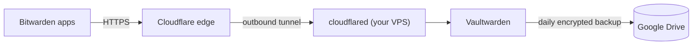

# PassVault

Your own password manager, on your own server, backed up to your own cloud.
Self-hosted [Vaultwarden](https://github.com/dani-garcia/vaultwarden) behind a
Cloudflare Tunnel: no open ports, no certificates, no exposed IP. Uses the
official Bitwarden apps on macOS, Windows, Linux, and every browser.



The tunnel means the server dials *out* to Cloudflare and traffic comes back
down that pipe. Nothing listens for inbound vault traffic, so there is no
firewall to open and nothing to attack directly. If the tunnel is down, the
vault is simply offline, never exposed.

## Quickstart

You need: a small VPS (1 GB RAM is plenty), a domain on Cloudflare, and a
laptop with `git` and `ssh`.

1. **Configure** - create `.deploy.env` in the repo root:

   ```bash
   DEPLOY_HOST=<server IP>
   DEPLOY_USER=ubuntu
   DEPLOY_DOMAIN=vault.yourdomain.com
   DEPLOY_SSH_KEY="$(cat ~/.ssh/<your-key>)"  # key CONTENT, never a path
   ```
   Then `chmod 600 .deploy.env` and SSH to the server once to accept its host key.

2. **Tunnel** (one-time): `./tunnel-init.sh` - installs `cloudflared` on the
   server and prints a login URL. Click **Authorize**, and it creates the
   tunnel, writes the config, and points your DNS at it.

3. **Deploy**: on the server run `cp .env.example .env` and set `DOMAIN`,
   then from your laptop `./deploy.sh`. Check that
   `https://vault.yourdomain.com/alive` returns `200`.

4. **Use it**: open your domain, create your account, enable 2FA right away,
   and keep the master password offline (there is no recovery). Install the
   official Bitwarden app or extension, choose "Self-hosted", enter your URL.

Detailed steps, including email verification, admin panel, and onboarding
hardening: [`RUNBOOK.md`](RUNBOOK.md).

## Backups

A systemd timer runs daily at 04:00: SQLite snapshot, attachments, and config
are packed and uploaded **client-side encrypted** to your Google Drive. Files
appear there with scrambled names, which is the encryption working.

Retention prunes old backups automatically: the newest of each of the last
7 days, 4 weeks, and 3 months survives.

- Keep the crypt passwords offline. Without them, the Drive copies cannot be
  restored.
- Test a restore quarterly (three commands, RUNBOOK §7.6).
- Optionally export the vault from a Bitwarden client monthly too.

## CI/CD

A GitHub Actions workflow (`.github/workflows/deploy.yml`) deploys on demand
via the **Run workflow** button. It needs three repo secrets: `DEPLOY_HOST`,
`DEPLOY_USER`, `SSH_PRIVATE_KEY` (the key content, never a path). The deploy
excludes `data/`, `.env`, `cloudflared/`, and `backups/`, so CI cannot touch
credentials or vault data.

## Security notes

- Zero-knowledge: the server stores ciphertext only, and master passwords
  never leave your devices.
- Key-only SSH, fail2ban on vault and sshd logs, unattended security upgrades.
- No secrets are committed; `.gitignore` guards env files, data, and backups.

## Serverless alternative

`workers/` deploys the same Bitwarden-client experience fully serverless
(NodeWarden on Cloudflare Workers + D1, free tier, no VPS at all). See
[`workers/README.md`](workers/README.md).

## Docs

- [`RUNBOOK.md`](RUNBOOK.md) - full setup and operations guide
- [`SECRETS.md`](SECRETS.md) - which secrets exist, who generates them, where
  they live
